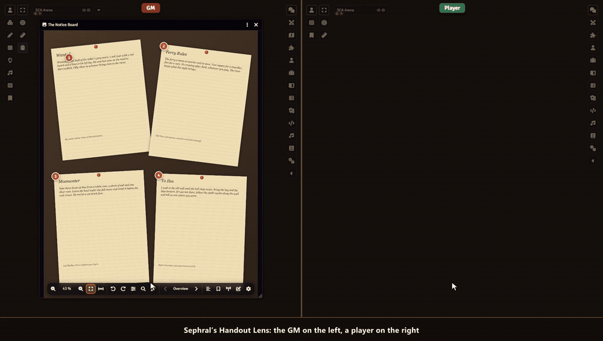

# Sephral’s Handout Lens

**The GM shows a letter, four torn diary pages or an old map, and the writing is too small to read. Handout Lens turns every shown picture into something players can actually read: zoom in, hold Shift for a magnifying lens, page through the notes one by one and keep every handout in a folder.**

[](#install)
[](https://discord.gg/7BjCgDYaBP)
[](https://github.com/Sephral)



## Highlights

* **Zoom where you point:** mouse wheel, trackpad pinch, two fingers on a tablet, double click or keys. Up to 800 % and back to the whole picture with one click.
* **A magnifying lens:** hold Shift and a round lens follows the mouse. The wheel changes its strength.
* **Reading aids:** contrast, brightness, grayscale, light on dark and a turn by any angle, so faded or tilted writing becomes readable.
* **Reading sections:** the GM frames each note once. Players page through them, and every note fills the window, turned straight.
* **Transcripts read aloud:** the GM can add the text of each note. Players read it in large print beside the picture or let the browser read it to them.
* **Follow the GM:** the GM zooms to a detail and every player with the picture open sees the same. Players can look around alone and follow again with one click.
* **A handout folder for every player:** each picture the GM shows lands in the player's folder, ready to open again next session. Players who join late get the picture the GM just showed.
* **Reading mode:** full screen, nothing but the picture.

## How it works

1. Enable the module. Every image window in Foundry now has a toolbar at the bottom.
2. Show a picture to your players as usual, with the eye button of an image or a journal page.
3. Optional: click the pencil in the toolbar, draw a frame around each note and type its transcript.

## Good to know

Writing stays blurry when the picture itself has too few pixels, and the GM gets a note when a shown picture is that small. While another module that zooms Foundry's image windows is active, Handout Lens leaves those windows to it.

## Install

Handout Lens is not in Foundry's module search yet. Copy this link:

```text
https://github.com/Sephral/sephrals-handout-lens/releases/latest/download/module.json
```

1. In Foundry's setup screen open **Add-on Modules** and click **Install Module**.
2. Paste the link into **Manifest URL** at the bottom of the window.
3. Click **Install**, then enable the module in your world.

On The Forge open the Bazaar, click **Install From Manifest** and paste the link.


Foundry VTT 13 and 14 · any game system · English and German

## Learn more

The toolbar, the keys, the reading sections and the settings are explained in the [manual](MANUAL.md). Questions or ideas? Join us on [Discord](https://discord.gg/7BjCgDYaBP). Looking for more? See [all modules by Sephral](https://github.com/Sephral).

## License

See [LICENSE.md](LICENSE.md).
